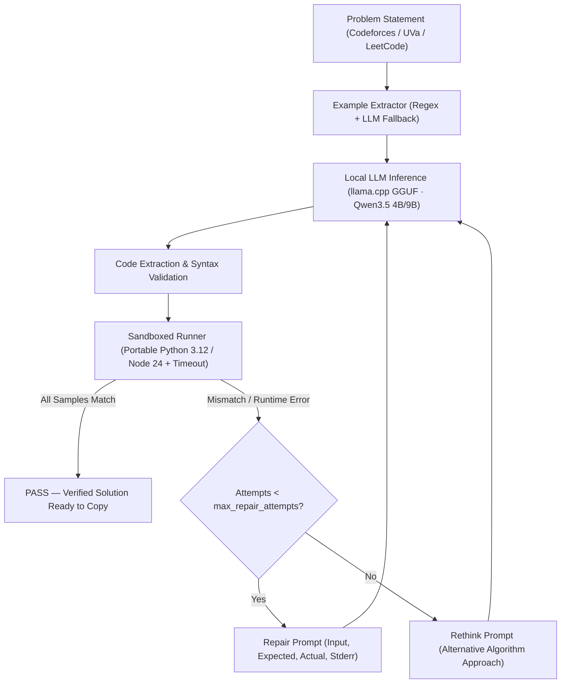

<div align="center">

# CodeSolver Offline

**Portable, 100% offline competitive programming AI assistant** powered by local LLMs (**`llama.cpp` + GGUF models** with automatic Vulkan GPU / CPU acceleration), automated sample-test extraction, sandboxed code execution, and an iterative **self-repair & rethink loop** for Python and JavaScript.

[](https://www.python.org/)
[](https://github.com/ggerganov/llama.cpp)
[](https://www.vulkan.org/)
[](https://github.com/fizsmx/ACM_program)
[](./LICENSE)

</div>

---

## How It Works (Solve → Test → Repair → Rethink)

Every generated solution is strictly syntax-checked and executed against the problem's sample inputs inside the bundled portable runtime — a solution is **never** marked `PASS` unless it passes the extracted examples.



---

## Key Features

- **100% Offline & Zero-Install Portability** — Runs directly from a local folder or USB drive with embedded **Python 3.12**, **Node 24**, and **`llama.cpp`** binaries (no admin privileges or Internet required).
- **Hardware-Aware Profile Auto-Selection** — Automatically detects available free RAM and Vulkan GPU support to select between `MEDIUM` (4B model, ~5 GB RAM) and `HIGH` (9B model, ~10 GB RAM).
- **Zero-Framework Architecture** — Backend written purely with the Python Standard Library (`app/`) and a lightweight Vanilla HTML/JS web UI (`web/`) served on `http://127.0.0.1:8765/`.
- **Web UI + CLI Fallback** — Paste statements into the browser UI or invoke headless solving straight from the terminal.
- **Automated Unit Tests** — Includes 17 offline unit tests (`tests/test_units.py`) validating example parsing, output comparison, runners, and code extraction without requiring a loaded LLM.

---

## Repository Layout

| Directory / File | Purpose |
| :--- | :--- |
| `app/` | Zero-dependency Python backend (server, example parser, solver loop, sandboxed runners) |
| `web/` | Lightweight local web interface (Vanilla HTML/CSS/JS) |
| `prompts/` | Structured prompts (`solve`, `repair`, `rethink`, `extract_examples`) |
| `config/config.json` | Hardware profiles, timeouts, ports, and sampling configuration |
| `tests/` | Offline unit test suite (`test_units.py`) and benchmark problems |
| `tools/` | Developer utilities (`fetch_deps.py` to bundle `llama.cpp`, runtimes & GGUF models; `bench.py`) |
| `CodeSolver.bat` / `CodeSolver.sh` | Cross-platform one-click launchers |

---

## Quick Start

### 1. Prepare Portable Bundle (Development Machine with Internet)

```bash
# Download llama.cpp, portable Python/Node runtimes, and Qwen3.5 9B/4B GGUF models
python tools/fetch_deps.py

# Optional extra models
python tools/fetch_deps.py --only coder7b,model2b

# Run the offline unit test suite (no LLM required)
python -X utf8 tests/test_units.py -v
```

### 2. Offline Usage

- **Web UI:** Run `CodeSolver.bat` (Windows) or `./CodeSolver.sh` (Linux/macOS), open `http://127.0.0.1:8765/`, paste a statement, pick Python or JavaScript, and press **Solve** (`Ctrl + Enter`).
- **CLI Mode:**

```bash
CodeSolver.bat solve problem.txt --lang python --out solution.py
```

---

## Ethics & Fair Use

This tool does not hide processes or bypass system/proctoring restrictions. Always verify that offline assistants are permitted under the rules of your event or practice environment before use.

See also [CodeSolver_Plan_Maestro.md](./CodeSolver_Plan_Maestro.md) and [docs/TROUBLESHOOTING.md](./docs/TROUBLESHOOTING.md).

---

## License

Released under the [MIT License](./LICENSE).

<div align="center">
  Built by <a href="https://github.com/fizsmx"><strong>Fisbert Chavez (@fizsmx)</strong></a>
</div>
